# Sorriso em Dados 

Plataforma que centraliza doadores, parceiros e indicadores da Turma do Bem, com painel de captação e relacionamento. Projeto da disciplina Front-End Design Engineering (turma 1TDSPS).

Na Sprint 01 o projeto foi construído como um protótipo estático para desktop. Na **Sprint 02** ele evoluiu para um site **responsivo e interativo**, com CSS adaptado a diferentes dispositivos e JavaScript próprio.

## Status da Sprint 02
✅ Concluída.

## Funcionalidades implementadas
- **Design responsivo** com `@media` queries: mobile (até 480px), tablet (a partir de 768px) e desktop (a partir de 992px e 1300px), sem rolagem horizontal.
- **Menu hambúrguer** em telas menores que 992px, que abre e fecha por clique, com atributos de acessibilidade (`aria-expanded`, `aria-controls`).
- **Validação do formulário de contato** com JavaScript, sem o atributo `required`: confere nome, e-mail, mensagem e consentimento (LGPD), mostra mensagens de erro, destaca os campos com borda vermelha e impede o envio inválido com `preventDefault()`.
- **Filtro da tabela de doações** no painel, por situação (Todas, Confirmadas e Pendentes).
- **Gráfico de barras com valores** e descrição em texto para acessibilidade.
- **Ajustes do feedback da Sprint 01**: hierarquia de títulos, `alt` descritivo nas fotos, HTML com um elemento por linha, CSS sem classes não utilizadas e link da fonte dos indicadores.

## Tecnologias
HTML5, CSS3 e JavaScript puro (sem frameworks e sem bibliotecas externas), Git e GitHub.

## Estrutura de pastas
```
index.html  dashboard.html  integracao.html  sobre.html
integrantes.html  faq.html  contato.html
css/style.css
js/script.js
imagens/
README.md
```
- `css/style.css`: estilos do site, organizados por seções e com as media queries no final.
- `js/script.js`: menu hambúrguer, validação do formulário e filtro da tabela.
- `imagens/`: logo, ícones, fotos dos integrantes e prints das páginas.

## Link do repositório
https://github.com/gialcard7-gif/Sorriso-em-Dados

## Visualização do projeto
[Acessar o site](https://gialcard7-gif.github.io/Sorriso-em-Dados/)

## Autores
| Nome completo | RM | Turma | GitHub | LinkedIn |
|---|---|---|---|---|
| Beatriz Fernandes Silva | RM576409 | 1TDSPS | [@olabeatrizfsilva](https://github.com/olabeatrizfsilva) | [LinkedIn](https://www.linkedin.com/in/beatrizsilva-salesb2b) |
| Diane Vinha Arantes | RM575041 | 1TDSPS | [@dianevinhaarantes](https://github.com/dianevinhaarantes) | [LinkedIn](https://www.linkedin.com/in/diane-arantes) |
| Giovanna Alcard Souza Silva | RM576375 | 1TDSPS | [@gialcard7-gif](https://github.com/gialcard7-gif) | [LinkedIn](https://www.linkedin.com/in/giovanna-alcard) |
| Gleycianne Arruda de Freitas Silva | RM575040 | 1TDSPS | [@gleycifreitas](https://github.com/gleycifreitas) | [LinkedIn](https://www.linkedin.com/in/gleyci) |
| Isabella Fernandes dos Passos Prado | RM574951 | 1TDSPS | [@isabellaprado25](https://github.com/isabellaprado25) | [LinkedIn](https://www.linkedin.com/in/isabellaprado20) |

## Integrantes
| | | | | |
|:---:|:---:|:---:|:---:|:---:|
|  |  |  |  |  |
| **Beatriz** | **Diane** | **Giovanna** | **Gleyci** | **Isabella** |

## Imagens do projeto

### Página inicial
| Desktop | Tablet | Mobile |
|:---:|:---:|:---:|
| 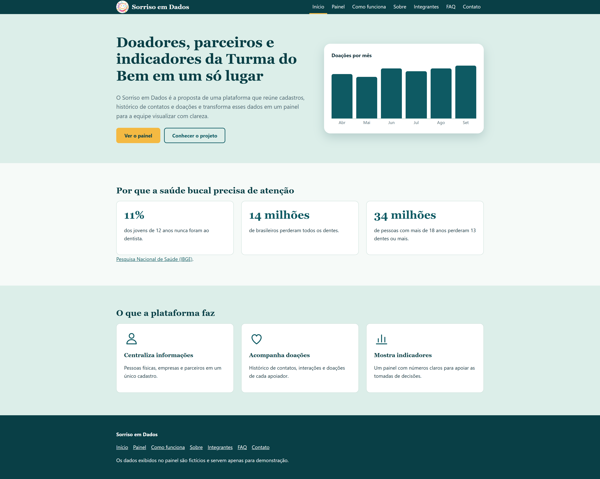 | 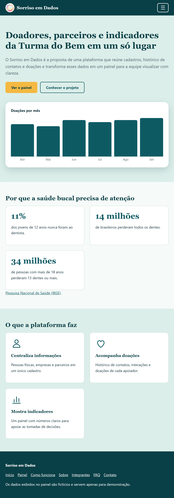 | 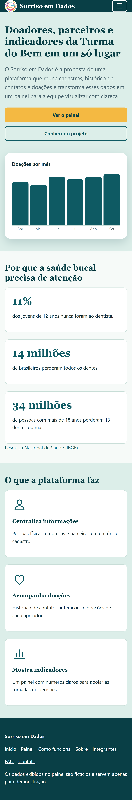 |

### Painel
| Desktop | Tablet | Mobile |
|:---:|:---:|:---:|
| 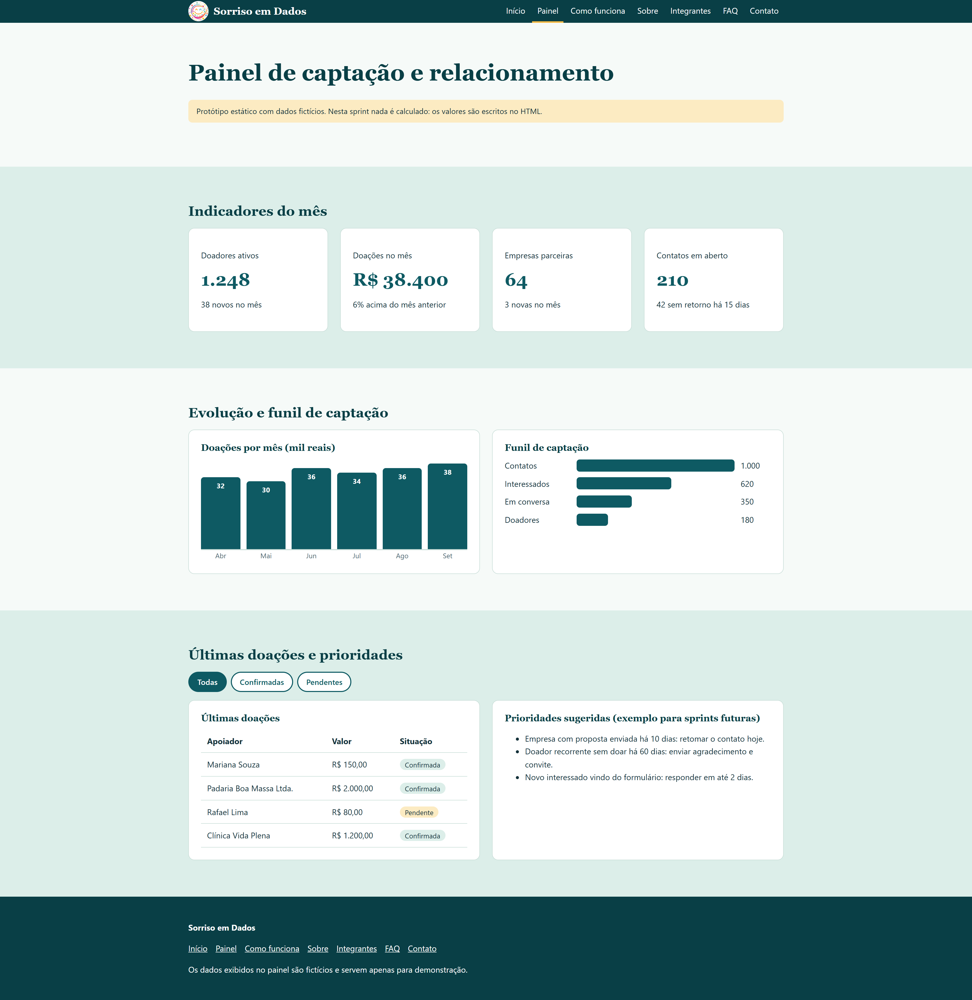 | 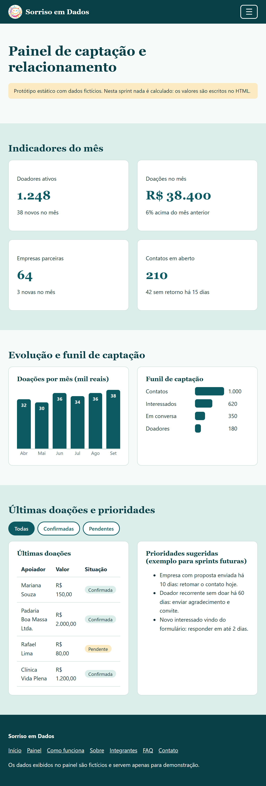 | 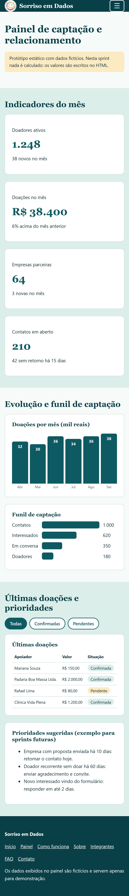 |

### Como funciona
| Desktop | Mobile |
|:---:|:---:|
| 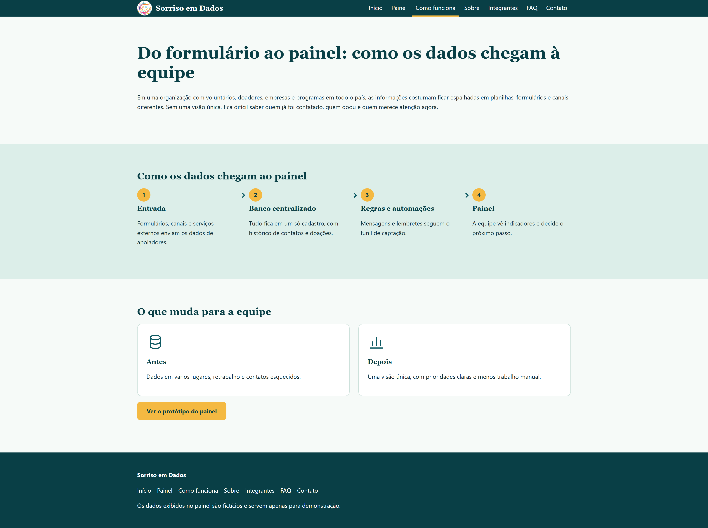 | 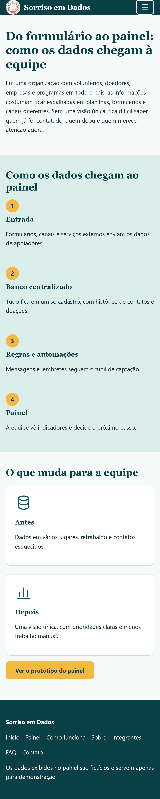 |

### Sobre
| Desktop | Mobile |
|:---:|:---:|
| 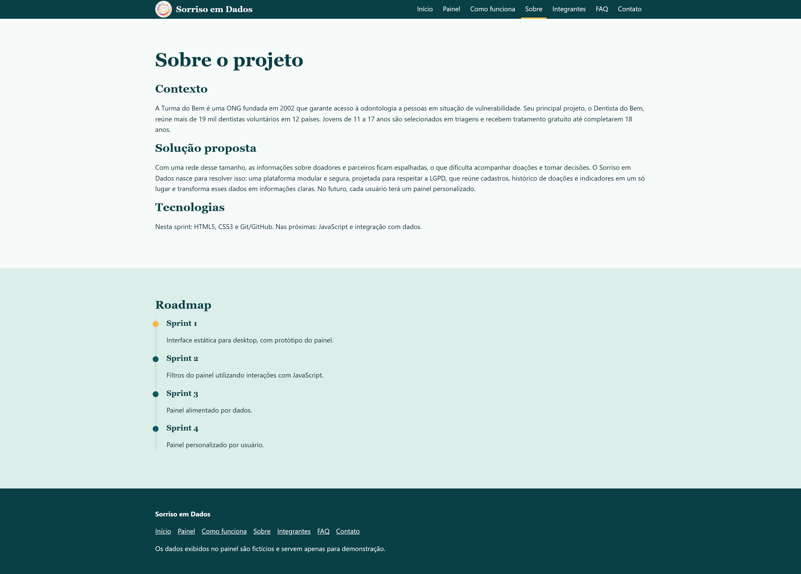 | 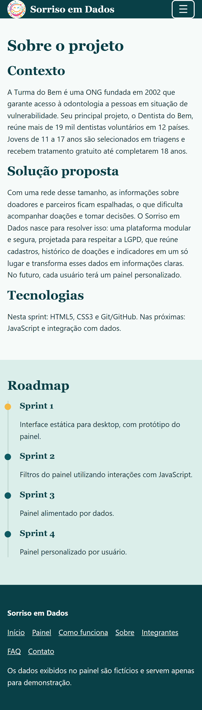 |

### Integrantes
| Desktop | Tablet | Mobile |
|:---:|:---:|:---:|
| 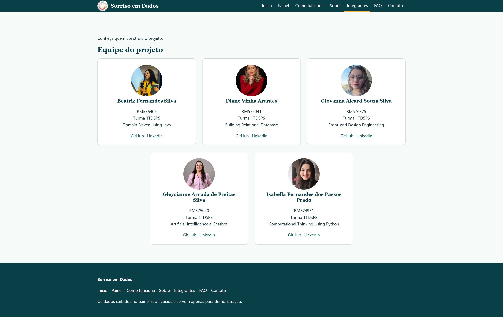 | 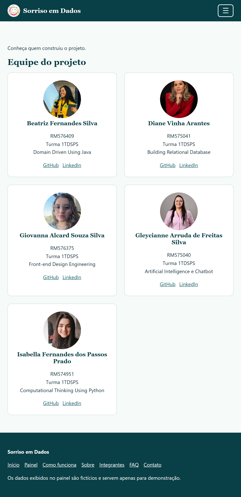 | 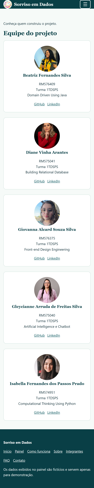 |

### FAQ
| Desktop | Mobile |
|:---:|:---:|
| 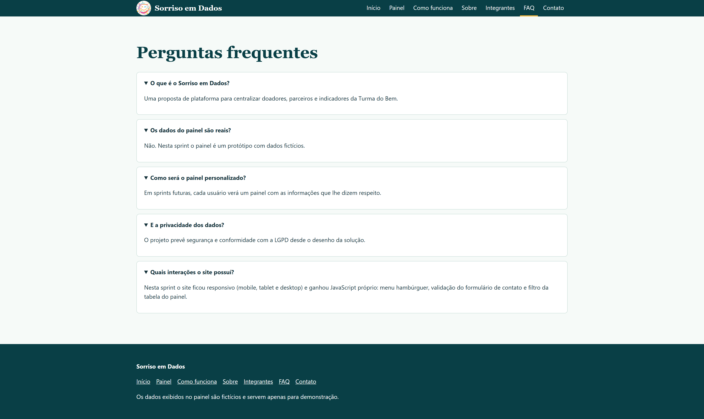 | 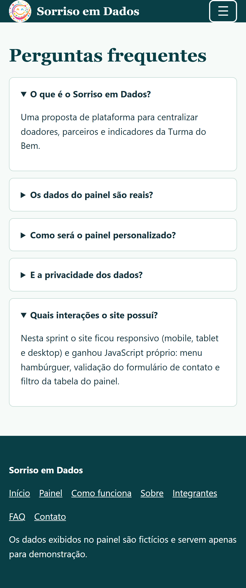 |

### Contato
| Desktop | Mobile |
|:---:|:---:|
| 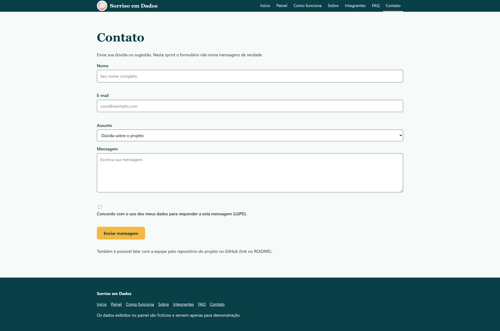 | 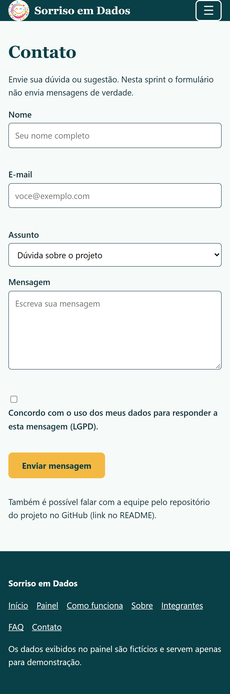 |

### Interações (Sprint 02)
| Menu hambúrguer | Validação do formulário | Filtro da tabela |
|:---:|:---:|:---:|
| 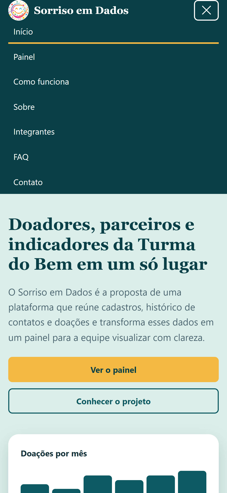 | 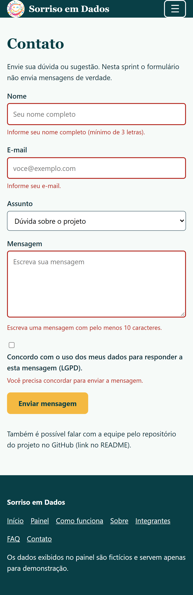 | 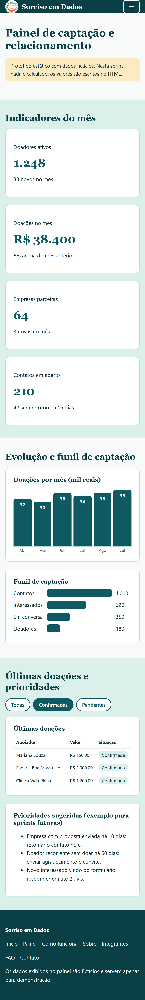 |

## Contato
Dúvidas, sugestões ou suporte sobre o projeto:
- Issues do repositório: https://github.com/gialcard7-gif/Sorriso-em-Dados/issues
- Perfis de cada autora: veja a tabela de [Autores](#autores)

